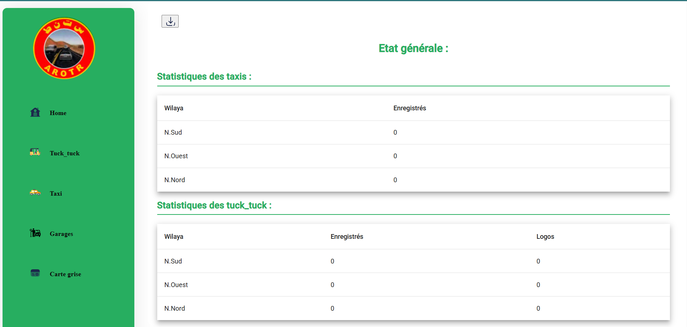
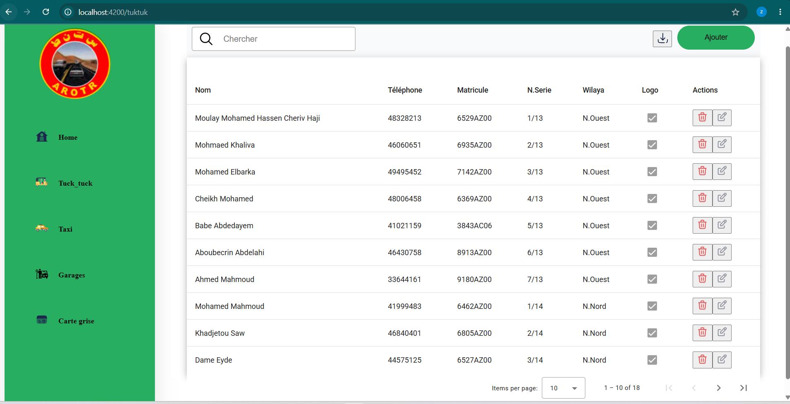
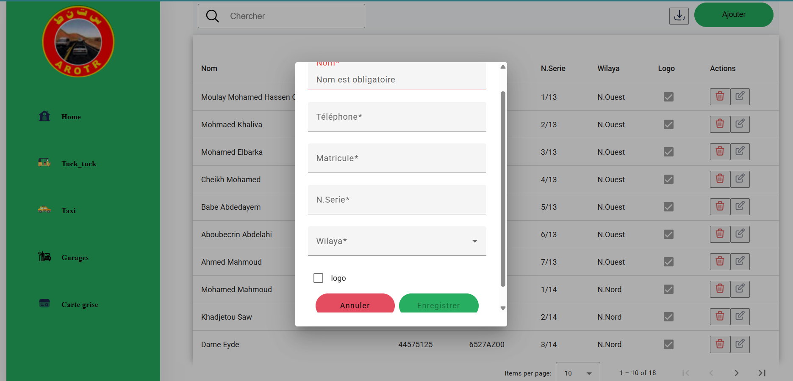
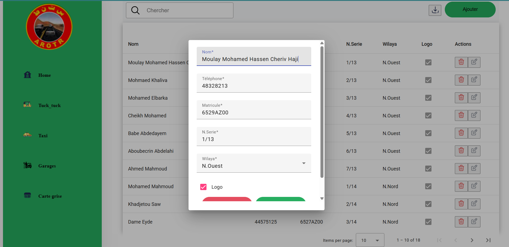
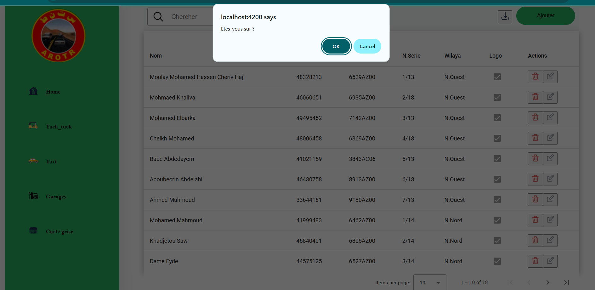

# CoreManage

A full-stack management application built to manage transportation-related operations, including garages, taxis, tuk-tuks, and cards.

## Overview

CoreManage is a web application developed with Angular, Spring Boot, and MySQL. It provides an interface for managing records and organizing operational data.

## Features

- Garage management
- Taxi management
- Tuk-tuk management
- Card management
- Create, view, edit, and delete records
- Angular-based user interface
- REST API backend
- MySQL database integration

## Technologies Used

### Frontend
- Angular
- TypeScript
- HTML5
- CSS3

### Backend
- Java
- Spring Boot
- Spring Data JPA
- Maven

### Database
- MySQL

## Project Structure

```text
CoreManage/
├── backend/
│   ├── src/
│   ├── pom.xml
│   └── mvnw
│
├── frontend/
│   ├── src/
│   ├── package.json
│   └── angular.json
│
├── screenshots/
│   ├── Dashboard.png
│   ├── tuckTuck.png
│   ├── addTuckt.png
│   ├── editTuckt.png
│   └── deletTuckt.png
│
└── README.md
```

## Getting Started

### Prerequisites

- Java JDK
- Node.js and npm
- MySQL
- Git

### 1. Clone the repository

```bash
git clone https://github.com/ZinhaHm/CoreManage.git
cd CoreManage

```

### 2. Configure the database

Create the MySQL database and configure the database connection in the backend's local configuration.

Do not publish real passwords or credentials.

### 3. Run the backend

Open a terminal:

```powershell
cd backend
.\mvnw.cmd spring-boot:run
```

### 4. Run the frontend

Open another terminal:

```powershell
cd frontend
npm install
npx ng serve
```

Open your browser at:

http://localhost:4200

## Screenshots

### Dashboard



### Tuk-tuk Management



### adding TuckTuck


### editing TuckTuck


### deleting TuckTuck


## Author

**Zeinebou**
GitHub: [@ZinhaHm](https://github.com/ZinhaHm)

---

*Developed as a full-stack software development project.*
